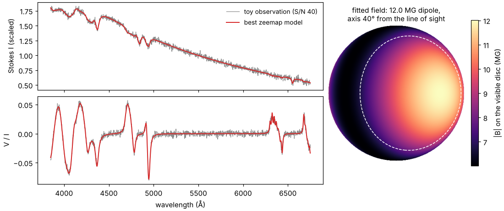

<h1 align="center">zeemap</h1>

<p align="center">
  <b>Map the magnetic fields of white dwarfs from their spectra, and find out how sure you can be.</b>
</p>

<p align="center">
  <a href="https://github.com/gullabi/zeemap/actions/workflows/tier1.yml"></a>
  <a href="LICENSE"></a>
  
  
</p>

Between a few per cent and about a fifth of white dwarfs have a magnetic field, depending on the sample, from a few
thousand gauss up to about a billion. The field splits and polarises the spectral lines (the Zeeman effect), so the
light and circular polarisation a star sends while it rotates carry an imprint of the field's shape. **zeemap reads that
imprint back.** It fits a field geometry (an offset dipole with quadrupole and octupole, or a centred expansion in
spherical harmonics up to l = 4) to phase-resolved Stokes I and V/I spectra.

<p align="center">
  
  <br><sub>The quick start below: a synthetic star (grey) and zeemap's best fit (red), and the field it found (dashed:
  where the line-of-sight component of the field changes sign).</sub>
</p>

Most such fits stop at one best geometry. But quite different fields can explain the same spectra, so zeemap keeps
looking:

- **It searches widely for the geometries that fit.** A search from many starting points groups the good solutions into
  *families*: solutions you can move between without the fit getting much worse. You see each distinct answer, not
  just the first one found.
- **It says how well each quantity is constrained.** For each family it measures how far each quantity can move before the fit gets
  clearly worse; on request (`--mcmc`) it also samples each solution. It fits the noise of each star, including noise
  correlated between pixels, and reports systematic shifts (another temperature, another library) next to the error
  bars, never added into them.
- **It is reproducible.** Every fit writes its configuration, versions, seed and input checksums to `run.json`; fits
  resume from checkpoints; the same seed gives the same result.
- **It is tested.** More than 450 checks run on every change: known answers, symmetries, injection and recovery of
  synthetic stars, MCMC tests ([docs/VERIFICATION.md](docs/VERIFICATION.md)). The long calibration and
  search-completeness checks are not built yet, so the report marks its intervals as uncalibrated.

## How it works

```
  observed spectra at several rotation phases           library of model spectra (you bring it)
  (intensity I and circular polarisation V/I)           one spectrum per (temperature, field strength B,
                 |                                       angle psi between the field and the line of sight)
                 |                                                    |
                 |    guess a field geometry, seen at inclination i   |
                 |    cover the star with ~5000-20 000 patches; each  |
                 |    patch has its own B and psi; look up its        |
                 |    spectrum; add up the visible patches  <---------+
                 |                         |
                 +---------->  compare  <--+  model spectra at the same phases
                                  |
            search very many geometries -> families of good fits -> error bars inside each one
```

zeemap does no radiative transfer itself. It needs a **library** of precomputed Stokes I and V spectra on a grid of
temperature, field strength and field angle, made by a magnetic model-atmosphere code. zeemap ships no library;
the libraries used so far were computed with MAGWD (S. Jordan, not public), and any code that writes the simple format
of [docs/FORMATS.md](docs/FORMATS.md) will do. To try zeemap without one, use the toy library generator in `tools/`.

zeemap is written from scratch and contains no code from other fitting programs or Numerical Recipes.

## Quick start (about 10 minutes, no data needed)

You need Python 3.12 or newer and [uv](https://docs.astral.sh/uv/) (or plain `pip`).

```bash
git clone https://github.com/gullabi/zeemap.git && cd zeemap
uv venv -p 3.12 .venv
uv pip sync --python .venv/bin/python requirements.lock      # the exact tested versions
uv pip install --python .venv/bin/python --no-deps -e .
#   (or simply: python -m pip install -e '.[dev]')

# a toy library, and a fake star observed at one phase: a centred 12 MG dipole whose axis is 40 degrees
# from the line of sight, Teff 13 000 K, S/N 40
export ZEEMAP_DATA=$PWD/../zeemap-data           # any directory outside the repository
.venv/bin/python tools/zeeman_library.py        $ZEEMAP_DATA/synth_zeeman
.venv/bin/python tools/zeeman_library.py inject $ZEEMAP_DATA/obs_dah12

# fit it (about 6 minutes on 4 cores)
.venv/bin/zeemap fit examples/synth_single.toml -o out/first --seed 1 --starts 40 --workers 4
less out/first/report.txt
```

The report lists the solutions found (*modes*) and their families. You should get back a 12.0 MG dipole whose axis is
40-41 degrees from the line of sight (`beta_deg` in the table of families side by side; `incl`, the tilt of the rotation axis, is not
constrained by a single phase). Teff, however, comes out near 11 700 K instead of 13 000 K, with an interval (11 530-11 910 K)
that misses the truth. The toy observation is made by the toy's own disc integration, not by zeemap's forward model,
and why Teff absorbs the difference is not yet understood: it is the first open question in
[docs/DECISIONS.md](docs/DECISIONS.md). Error bars describe the noise under the model, so a mismatch between model and
data shows up as a biased value, not as a wider interval. Add `--mcmc` for error bars from MCMC
inside each mode (slower). `docs/images/make_readme_figure.py` draws the figure above from `out/first`.

The commands are `zeemap fit`, `zeemap eval` (evaluate one geometry), `zeemap inject` (simulate an observation from
a configuration and your library; the quick start uses the toy tool instead, because it also makes the library).
Every configuration key you leave out takes its default from [src/zeemap/defaults.toml](src/zeemap/defaults.toml) (a
few, such as `model.fwhm`, must be given); `zeemap <command> --help` lists the command-line options.

## Documentation

| if you want to ... | read |
|---|---|
| prepare your library and observations | [docs/FORMATS.md](docs/FORMATS.md) |
| look up a term (family, mode, profile, tier, ...) | [docs/GLOSSARY.md](docs/GLOSSARY.md) |
| know what zeemap promises, requirement by requirement | [docs/SPEC.md](docs/SPEC.md) |
| understand how it works inside: the formulas and the module map | [docs/DESIGN.md](docs/DESIGN.md) |
| know how it is tested | [docs/VERIFICATION.md](docs/VERIFICATION.md) |
| know why it was built this way | [docs/DECISIONS.md](docs/DECISIONS.md) |
| contribute | [CONTRIBUTING.md](CONTRIBUTING.md) |

## Status

zeemap is **alpha** software (version 0.1). The search, likelihood, error bars and report are built and tested on
synthetic stars; fits of real stars, and the checks that need real libraries (tiers 2 and 3), are in progress.
Configuration keys and output formats can still change between minor versions; [CHANGELOG.md](CHANGELOG.md) lists
every change.

## Contributing and getting help

Questions, bug reports and ideas are welcome as [GitHub issues](https://github.com/gullabi/zeemap/issues). To change
the code, read [CONTRIBUTING.md](CONTRIBUTING.md): it takes you from a fresh clone to a pull request in a few steps.
Please follow our [code of conduct](CODE_OF_CONDUCT.md). Report security problems privately, as
[SECURITY.md](SECURITY.md) explains.

## Citing

If zeemap helps your research, please cite it. [CITATION.cff](CITATION.cff) has the details, and GitHub's "Cite this
repository" button turns it into BibTeX.

## Licence

BSD 3-Clause, see [LICENSE](LICENSE). Copyright (c) 2026, the zeemap contributors.
